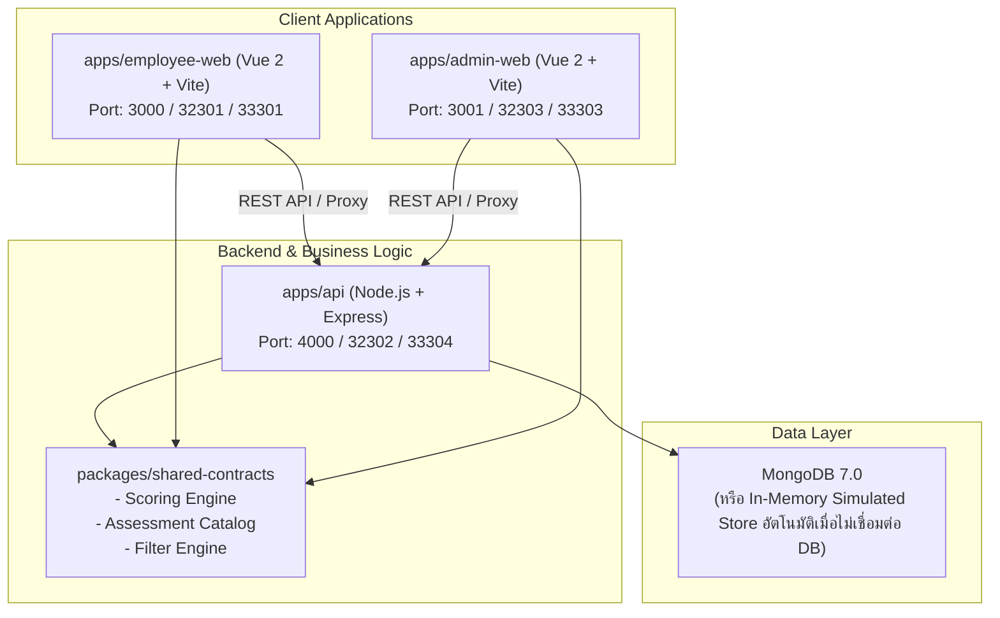

# Mental Health Assessment Platform (ระบบประเมินสุขภาพใจสำหรับองค์กร)

แพลตฟอร์มประเมินและติดตามสุขภาวะทางใจของพนักงานในองค์กร พัฒนาขึ้นด้วยสถาปัตยกรรม Modular Monorepo เพื่อรองรับทั้งฝั่งพนักงาน (Employee Portal) และฝ่ายทรัพยากรบุคคล (Admin & Super Admin Portal) ตามมาตรฐานกรมสุขภาพจิตและข้อกำหนด PDPA อย่างเคร่งครัด

---

## 📑 สารบัญ (Table of Contents)

1. [ภาพรวมสถาปัตยกรรม (Architecture Overview)](#-ภาพรวมสถาปัตยกรรม-architecture-overview)
2. [โครงสร้างไดเรกทอรี (Directory Structure)](#-โครงสร้างไดเรกทอรี-directory-structure)
3. [ความต้องการพื้นฐานของระบบ (Prerequisites)](#-ความต้องการพื้นฐานของระบบ-prerequisites)
4. [การติดตั้งและเริ่มต้นใช้งาน (Quick Start)](#-การติดตั้งและเริ่มต้นใช้งาน-quick-start)
5. [การตั้งค่า Environment Variables](#-การตั้งค่า-environment-variables)
6. [คำสั่งที่ใช้ในการพัฒนา (Available Scripts)](#-คำสั่งที่ใช้ในการพัฒนา-available-scripts)
7. [การรันด้วย Docker Compose (Local / UAT / PRD)](#-การรันด้วย-docker-compose-local--uat--prd)
8. [บัญชีผู้ใช้งานเริ่มต้นสำหรับทดสอบ (Default Accounts)](#-บัญชีผู้ใช้งานเริ่มต้นสำหรับทดสอบ-default-accounts)
9. [ฟีเจอร์สำคัญด้านความปลอดภัยและ PDPA (Security & Compliance)](#-ฟีเจอร์สำคัญด้านความปลอดภัยและ-pdpa-security--compliance)
10. [เอกสารอ้างอิงและแบบประเมิน (Documentation & Specifications)](#-เอกสารอ้างอิงและแบบประเมิน-documentation--specifications)

---

## 🏛 ภาพรวมสถาปัตยกรรม (Architecture Overview)

ระบบถูกออกแบบเป็น **Monorepo** โดยใช้ npm workspaces แบ่งออกเป็น 3 แอปพลิเคชันหลัก และ 1 Shared Contracts Package:



### ไฮไลท์ทางเทคนิค (Technical Highlights)
- **Shared Contracts (`packages/shared-contracts`):** รวมกฎการคิดคะแนน (Scoring Engine ครบ 5 ด้าน ได้แก่ Burnout, ST-5, 9Q, 8Q, RQ), กฎการกรองข้อมูลแบบหลายมิติ (Multidimensional Filter Engine) และ Catalog แบบประเมิน เพื่อให้ทั้ง Frontend และ Backend ใช้ Logic เดียวกันแบบ Single Source of Truth
- **Dual Database Mode:** รองรับทั้งการเชื่อมต่อ MongoDB จริง (ผ่าน `MONGODB_URI`) และโหมด High-Performance In-Memory Simulated Document Store อัตโนมัติในเครื่อง Development ทำให้สามารถเริ่มพัฒนาได้ทันทีโดยไม่ต้องลง MongoDB
- **3 Swimlanes Role Hierarchy:** รองรับ 3 บทบาทชัดเจน ได้แก่ `Employee`, `Admin` (จัดการผลประเมิน), และ `Super Admin` (ควบคุมระบบและกำหนดสิทธิส่งออกข้อมูลของ Admin)

---

## 📁 โครงสร้างไดเรกทอรี (Directory Structure)

```text
.
├── apps/
│   ├── admin-web/              # เว็บแอปพลิเคชันสำหรับ HR / Admin / Super Admin (Vue 2 + Vite)
│   ├── employee-web/           # เว็บแอปพลิเคชันสำหรับพนักงานทำแบบประเมิน (Vue 2 + Vite)
│   └── api/                    # บริการ Backend REST API (Express.js)
├── packages/
│   └── shared-contracts/       # โมดูลกลาง: Scoring Engine, Filter Engine, Assessment Catalog
├── docs/
│   ├── adr/                    # บันทึกการตัดสินใจทางสถาปัตยกรรม (Architecture Decision Records 0001-0033)
│   ├── specs/                  # ข้อกำหนดความต้องการระบบและแบบประเมินฉบับสมบูรณ์
│   ├── tasks/                  # รายละเอียด Task การพัฒนา Ticket 01 - Ticket 15
│   ├── references/             # เอกสารอ้างอิง User Journey (PDF) และรูปภาพหน้าจอต้นแบบ
│   ├── domain-model.md         # นิยามโครงสร้างข้อมูลโดเมน (Domain Model)
│   └── glossary.md             # อภิธานศัพท์และคำจำกัดความของระบบ
├── deliverables/               # เอกสารส่งมอบและแพ็กเกจนำเสนอสำหรับ HR และลูกค้า
├── scripts/                    # สคริปต์เสริมสำหรับนักพัฒนา (Developer Utilities)
├── tools/                      # สคริปต์สร้างสไลด์และเอกสารยืนยันความต้องการ (Python)
├── docker-compose.yml          # Docker Compose สำหรับ Local Development
├── docker-compose.uat.yml      # Docker Compose จำลองสภาพแวดล้อม UAT (แยก Port ฝั่ง User/Admin)
├── docker-compose.prd.yml      # Docker Compose จำลองสภาพแวดล้อม Production
├── .editorconfig               # มาตรฐานฟอร์แมตโค้ดสำหรับ Editor
├── .gitignore                  # กฎการละเว้นไฟล์สำหรับ Git
├── .dockerignore                # กฎการละเว้นไฟล์สำหรับ Docker Build
├── .env.example                # ตัวอย่างการตั้งค่า Environment Variables
├── package.json                # Root package.json พร้อม Workspace Scripts
└── PROGRESS.md                 # บันทึกประวัติและสถานะการพัฒนา Ticket ทั้งหมด
```

---

## ⚙️ ความต้องการพื้นฐานของระบบ (Prerequisites)

- **Node.js**: เวอร์ชัน `>= 20.0.0`
- **npm**: เวอร์ชัน `>= 10.0.0`
- **Docker & Docker Compose** (ทางเลือกสำหรับทดสอบ Containerized Environment)

---

## 🚀 การติดตั้งและเริ่มต้นใช้งาน (Quick Start)

### 1. ติดตั้ง Dependencies ทั้งหมดในครั้งเดียว
คำสั่งเดียวที่ root จะทำการติดตั้ง dependencies ของทุก app และ package:
```bash
npm install
```

### 2. กำหนดค่า Environment Variables
คัดลอกไฟล์ `.env.example` ไปเป็น `.env`:
```bash
cp .env.example .env
```
*(ค่าเริ่มต้นถูกกำหนดไว้ให้พร้อมรันในโหมด In-Memory Simulated Store ได้ทันที)*

### 3. รันเพื่อการพัฒนาแบบ Local (เปิด 3 Terminal)

**Terminal 1: รัน Backend API**
```bash
npm run dev:api
# API พร้อมทำงานที่ http://localhost:4000
```

**Terminal 2: รัน Employee Web**
```bash
npm run dev:employee
# เว็บพนักงานพร้อมทำงานที่ http://localhost:3000
```

**Terminal 3: รัน Admin Web**
```bash
npm run dev:admin
# เว็บ Admin พร้อมทำงานที่ http://localhost:3001
```

---

## 🔐 บัญชีผู้ใช้งานเริ่มต้นสำหรับทดสอบ (Default Accounts)

ระบบมาพร้อม Mock Accounts ในโหมด Local Development:

| บทบาท (Role) | บัญชีผู้ใช้ (Username) | รหัสผ่าน (Password) | สิทธิการใช้งาน |
| :--- | :--- | :--- | :--- |
| **Super Admin** | `superadmin` | `SuperAdmin@123456!` | เข้าถึงทุกหน้า, จัดการสิทธิ์ Admin, ส่งออก Excel ได้ |
| **Admin** (ทั่วไป) | `admin` | `Admin@123456!` | ดู Dashboard, ตารางผลประเมิน, ส่งออก Excel ได้ |
| **Admin View Only** | `admin_view` | `Admin@123456!` | ดูสถิติและตารางผลรายบุคคล (ปุ่มส่งออกถูกซ่อน) |
| **Employee** | Mock Auto-login | - | เข้าผ่าน Portal พนักงานเพื่อทำแบบประเมิน |

---

## 📜 คำสั่งที่ใช้ในการพัฒนา (Available Scripts)

คำสั่งทั้งหมดสามารถรันได้จาก Root Directory:

| คำสั่ง | คำอธิบาย |
| :--- | :--- |
| `npm run build` | บิลด์ Frontend ทั้งหมด (`employee-web` และ `admin-web`) |
| `npm test` | รันชุดทดสอบ Unit Tests ของทุก Workspace |
| `npm run clean` | ลบโฟลเดอร์ `dist` และ build cache ของทุกแอป |
| `npm run dev:api` | รัน API ในโหมด Watch (Port 4000) |
| `npm run dev:employee` | รันเว็บพนักงานในโหมด Dev (Port 3000) |
| `npm run dev:admin` | รันเว็บ Admin ในโหมด Dev (Port 3001) |
| **Docker Scripts** | |
| `npm run docker:dev` | รันระบบ Local Dev ผ่าน Docker Compose |
| `npm run docker:down` | หยุดและลบ Container ของ Local Dev |
| `npm run docker:uat` | บิลด์และรันสภาพแวดล้อม UAT (User & Admin Isolated Ports) |
| `npm run docker:uat:down` | หยุดสภาพแวดล้อม UAT |
| `npm run docker:prd` | บิลด์และรันสภาพแวดล้อม Production |
| `npm run docker:prd:down` | หยุดสภาพแวดล้อม Production |

---

## 🐳 การรันด้วย Docker Compose (Local / UAT / PRD)

ระบบรองรับการแยก Port และ Container ตามข้อกำหนดเครือข่ายความมั่นคงปลอดภัยสูง:

### พอร์ตในแต่ละสภาพแวดล้อม:
| Service | Local Dev | UAT Environment | PRD Environment |
| :--- | :---: | :---: | :---: |
| **Employee Frontend** | `3000` | `32301` | `33301` |
| **Employee Backend** | `4000` | `32302` | `33302` |
| **Admin Frontend** | `3001` | `32303` | `33303` |
| **Admin Backend** | `4000` | `32304` | `33304` |
| **MongoDB Database** | `27017` | `27018` | `27019` |

---

## 🛡️ ฟีเจอร์สำคัญด้านความปลอดภัยและ PDPA (Security & Compliance)

1. **Non-Disclosure of Raw Answers (PDPA Compliance):**
   - ฝ่าย HR/Admin จะเห็นเฉพาะ **ระดับผลการประเมิน (Level)** และ **คะแนนรวม (Score)**
   - ระบบไม่เปิดเผยคำตอบรายข้อเด็ดขาด เพื่อสร้างความไว้วางใจและคุ้มครองข้อมูลส่วนบุคคลของพนักงาน
2. **Small-Cohort Suppression ($n < 5$):**
   - ใน Aggregate Dashboard หากการกรองมิติข้อมูลใดมีจำนวนกลุ่มตัวอย่างน้อยกว่า 5 คน ระบบจะทำการเซ็นเซอร์ค่าสถิติเพื่อป้องกันการคาดเดาผลรายบุคคล
3. **Argon2id Authentication & Account Lockout:**
   - การเข้ารหัสรหัสผ่านฝั่ง Admin ด้วยอัลกอริทึม Argon2id
   - ระบบป้องกัน Brute-force Lockout อัตโนมัติเมื่อกรอกผิดเกิน 5 ครั้ง (ระงับ 15 นาที)
4. **Secure Export Verification:**
   - การ Export ข้อมูลต้องยืนยันรหัสผ่านอีกครั้ง (Password Re-confirmation)
   - ไฟล์ Export เป็นฟอร์แมต Excel เท่านั้น และจำกัดสิทธิ์เฉพาะ Admin ที่ได้รับอนุญาต
   - มีระบบบันทึก Audit Trail ทุกครั้งที่มีการดาวน์โหลดหรือเปลี่ยนแปลงข้อมูล

---

## 📚 เอกสารอ้างอิงและแบบประเมิน (Documentation & Specifications)

- **Architecture Decision Records:** อ่านประวัติการตัดสินใจออกแบบได้ที่ [`docs/adr/`](docs/adr/) (ครอบคลุม ADR 0001 - 0033)
- **System Specifications:** ข้อกำหนดความต้องการทางเทคนิคและสถิติ [`docs/specs/2026-09-05-employee-well-being-survey-spec.md`](docs/specs/2026-09-05-employee-well-being-survey-spec.md)
- **Domain Model:** แบบจำลองข้อมูล [`docs/domain-model.md`](docs/domain-model.md)
- **Glossary:** อภิธานศัพท์ทางการแพทย์และเทคโนโลยี [`docs/glossary.md`](docs/glossary.md)
- **User Journey Reference:** ผังการใช้งาน 24 ขั้นตอนและ 3 Swimlanes [`docs/references/User Journey ระบบตรวจสอบสุขภาพใจ.pdf`](docs/references/User Journey ระบบตรวจสอบสุขภาพใจ.pdf)
- **Sprint Development Tasks:** รายละเอียด Ticket การพัฒนา Ticket 01 ถึง 15 [`docs/tasks/`](docs/tasks/)
