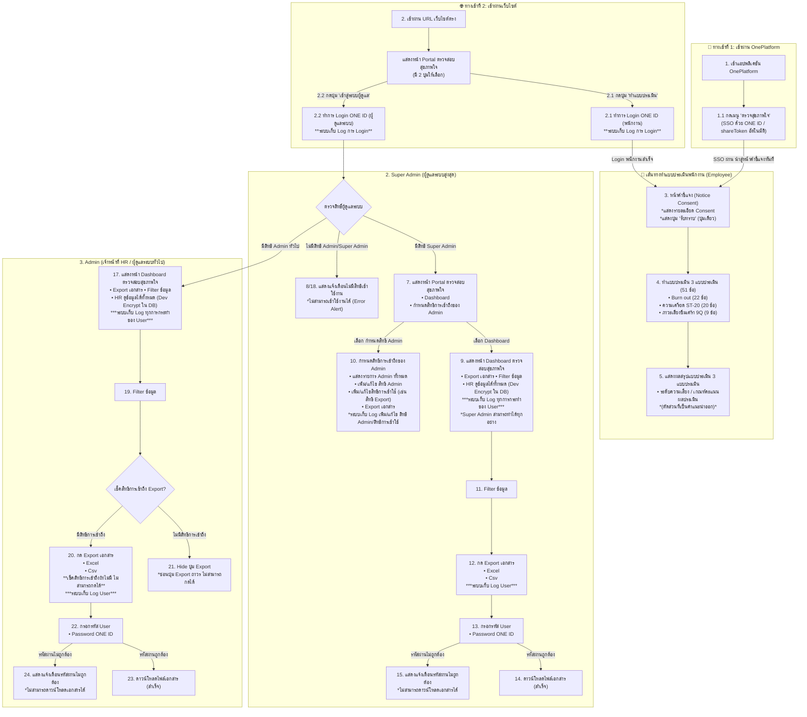
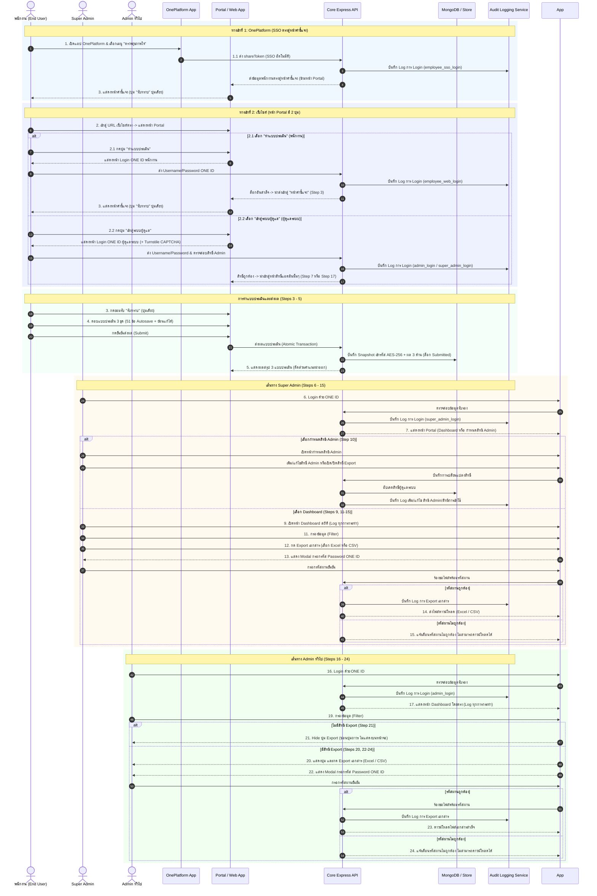

# User Journey: ระบบตรวจสอบสุขภาพใจ (ฉบับอัปเดต 24 ขั้นตอน 3 บทบาท)
**เอกสารประกอบชุดยืนยันความต้องการ (HR Requirement Confirmation Pack)**  
*อ้างอิง: `User Journey ระบบตรวจสอบสุขภาพใจ.pdf`, `01_เอกสารยืนยันความต้องการระบบประเมินสุขภาพใจ.docx` และ Interactive Prototype*  
*วันที่จัดทำ: 8 กันยายน 2569 | สถานะ: ฉบับสมบูรณ์ครอบคลุม 3 บทบาทและ 24 ขั้นตอน*

---

## 1. บทนำและภาพรวมของเส้นทางผู้ใช้ (Executive Journey Overview)

แผนผัง User Journey ระบบตรวจสอบสุขภาพใจฉบับอัปเดต กำหนดเส้นทางการใช้งานของระบบอย่างละเอียด โดยจำแนกผู้ใช้ออกเป็น **3 บทบาทหลัก (3 Swimlanes)** และระบุจุดเชื่อมต่อและเงื่อนไขการทำงานครบถ้วนทั้ง **24 ขั้นตอน**:

1. **พนักงาน (Employee) มี 2 รูปแบบทางเข้า:**
   - **ทางเข้าที่ 1: เข้าผ่าน OnePlatform (SSO ตรง):** ผู้ใช้งานเปิดแอป OnePlatform -> กดเลือกเมนู "ตรวจสุขภาพใจ" -> ระบบทำการ Single-Sign-On (SSO) ด้วย ONE ID (shareToken) อัตโนมัติ -> **ระบบพาไปยัง "หน้าคำชี้แจง" (Step 3) ทันที** (ข้ามหน้า Portal ไปเลยเพื่อความรวดเร็ว)
   - **ทางเข้าที่ 2: เข้าผ่านเว็บไซต์ (Direct Web Portal):** แสดง **หน้า Portal ตรวจสอบสุขภาพใจ** โดยมีปุ่มให้เลือก 2 ปุ่ม:
     - **2.1 ปุ่ม "ทำแบบประเมิน":** ผู้ใช้กดทำแบบประเมิน -> ระบบพาไปหน้า **Login ONE ID (พนักงาน)** -> เมื่อล็อกอินสำเร็จ -> **ระบบพาไปหน้า "คำชี้แจง" (Step 3)**
     - **2.2 ปุ่ม "เข้าสู่ระบบผู้ดูแล":** ผู้ใช้กดเข้าสู่ระบบผู้ดูแล -> ระบบพาไปหน้า **Login ONE ID (ผู้ดูแลระบบ)** -> เมื่อล็อกอินสำเร็จ -> ตรวจสอบสิทธิ์ -> **ระบบพาไปหน้าสิทธิแอดมินนั้นๆ** (Super Admin ➔ Portal/Dashboard, Admin ➔ Dashboard)
2. **Super Admin (ผู้ดูแลระบบสูงสุด):** ล็อกอินผ่าน ONE ID (จากปุ่ม 2.2 บนหน้า Portal หรือ Direct Admin URL) -> ตรวจสอบสิทธิ์ Super Admin -> เข้าสู่หน้า **Portal ตรวจสอบสุขภาพใจ** เพื่อเลือกไปที่ **Dashboard** (ดูสถิติ, Filter, ดูข้อมูลรายบุคคลแบบ Unmasked โดย Dev Encrypt ข้อมูลใน DB, Export Excel/CSV พร้อมยืนยัน Password ONE ID) หรือ **กำหนดสิทธิการเข้าถึงของ Admin** (ดูรายการ Admin, เพิ่ม/แก้ไขสิทธิ์ Admin, มอบหมายสิทธิ์การ Export, Export เอกสารรายชื่อสิทธิ์ พร้อมเก็บบันทึก Log ทุกการเปลี่ยนแปลง)
3. **Admin (ผู้ดูแลระบบทั่วไป / HR):** ล็อกอินผ่าน ONE ID (จากปุ่ม 2.2 บนหน้า Portal หรือ Direct Admin URL) -> ตรวจสอบสิทธิ์ Admin -> ตรงเข้าสู่หน้า **Dashboard** ทันที (ไม่มีสิทธิ์เข้าหน้ากำหนดสิทธิ์ Admin) -> ดูข้อมูลรายบุคคลและระดับความเสี่ยง 3 ด้าน (HR ดูข้อมูลที่แสดงได้ทั้งหมดเพื่อการดูแลพนักงาน) -> ใช้งาน Filter -> ตรวจสอบสิทธิ์ Export: หากมีสิทธิ์ ให้กด Export (Excel/CSV พร้อมยืนยัน Password ONE ID) หากไม่มีสิทธิ์ ให้ **Hide ปุ่ม Export**

---

## 2. นิยาม Persona ผู้ใช้งาน (User Personas)

### Persona 1: พนักงานทั่วไป (End User)
* **ชื่อตัวแทน:** คุณณิชา วัฒนกิจ (อายุ 30 ปี, Software Engineer, ฝ่ายเทคโนโลยีและนวัตกรรม)
* **บริบทการเข้าใช้ (2 รูปแบบทางเข้า):**
  1. **เข้าผ่าน OnePlatform:** เปิดแอปบนมือถือ เลือกเมนู "ตรวจสุขภาพใจ" ทำ SSO ด้วย ONE ID อัตโนมัติ ข้ามหน้า Portal และตรงสู่หน้าคำชี้แจงทันที
  2. **เข้าผ่านเว็บไซต์ตรง:** เข้าผ่าน URL เว็บไซต์ แสดงหน้า Portal มี 2 ปุ่มเลือก: กด "ทำแบบประเมิน" (2.1) เพื่อ Login ONE ID สู่หน้าคำชี้แจง หรือ กด "เข้าสู่ระบบผู้ดูแล" (2.2) เพื่อ Login ONE ID สู่หน้าสิทธิแอดมิน
* **เป้าหมาย:** ประเมินตนเอง 3 ด้าน (Burnout, ความเครียด, ภาวะเสี่ยงซึมเศร้า) ต้องการความสะดวก ปลอดภัย และความมั่นใจว่าคำตอบจะไม่รั่วไหล
* **ข้อกำหนดทางเทคนิค:** หน้าแรกของเว็บเป็น Portal พร้อม 2 ปุ่มทางเลือก -> เข้าสู่หน้า Consent มีปุ่ม "รับทราบ" ปุ่มเดียว -> ทำแบบประเมิน 3 ชุด (51 ข้อ) มีระบบ Autosave -> รับผลคะแนนและระดับความเสี่ยง (ตัดส่วนคำแนะนำออก)

### Persona 2: Super Admin (ผู้ดูแลระบบสูงสุด)
* **ชื่อตัวแทน:** คุณชานนท์ เมธาพร (Head of Information Security & Enterprise HR Governance)
* **บริบทการเข้าใช้:** ล็อกอินด้วยบัญชี ONE ID ที่มีบทบาท Super Admin ผ่านคอมพิวเตอร์สำนักงาน
* **เป้าหมาย:** ควบคุมความปลอดภัยของระบบทั้งหมด กำหนดสิทธิ์ให้แอดมินคนอื่น ควบคุมว่าใครมีสิทธิ์ส่งออกข้อมูล (Export) และดูรายงานสรุปภาพรวมทั้งหมดและข้อมูลรายบุคคลอย่างครบถ้วน (โดย Dev Encrypt ข้อมูลในฐานข้อมูล)
* **ข้อกำหนดทางเทคนิค:** มีหน้า Portal ผู้ดูแลระบบ เพื่อเลือกระหว่าง Dashboard และหน้ากำหนดสิทธิ Admin, สามารถเพิ่ม/แก้ไขสิทธิ์แอดมิน, สิทธิ์ Export, ส่งออกรายงาน Excel และ CSV ด้วยการยืนยัน Password ONE ID

### Persona 3: Admin ทั่วไป (HR People Operations)
* **ชื่อตัวแทน:** คุณกัญญา สุขสวัสดิ์ (HR People Operations & Well-being)
* **บริบทการเข้าใช้:** ล็อกอินด้วยบัญชี ONE ID ที่ได้รับมอบหมายบทบาท Admin
* **เป้าหมาย:** ติดตามตัวเลขสุขภาพจิตของพนักงานในบริษัทที่รับผิดชอบ กรองข้อมูลตามแผนกและช่วงอายุงาน เพื่อจัดโปรแกรมช่วยเหลือ โดย HR สามารถดูข้อมูลที่แสดงได้ทั้งหมด
* **ข้อกำหนดทางเทคนิค:** เข้าถึงหน้า Dashboard โดยตรง (ไม่เห็นหน้ากำหนดสิทธิ์แอดมิน), ดูข้อมูลรายบุคคลและผล 3 ด้านแบบ Unmasked, หากได้รับสิทธิ์ Export จาก Super Admin จะเห็นปุ่ม Export เอกสาร (Excel/CSV) และต้องยืนยัน Password ONE ID หากไม่ได้รับสิทธิ์ ปุ่ม Export จะถูกซ่อน (Hide) 100%

---

## 3. รายละเอียดขั้นตอนการทำงานทั้ง 24 สเต็ป (Step-by-Step Breakdown)

### 🌿 หมวดที่ 1: เส้นทางพนักงาน (Employee Journey - Steps 1 ถึง 5)

| ลำดับขั้นตอน | รายละเอียดการดำเนินการ | จุดสัมผัสระบบ (UI Touchpoint) | ข้อมูลที่เกี่ยวข้อง & กฎเกณฑ์ (Business Rules) | ระบบการจัดเก็บบันทึก (Audit / Logging) |
| :---: | :--- | :--- | :--- | :--- |
| **1** | **[ทางเข้าที่ 1] เข้าใช้งานผ่าน OnePlatform** | แอปพลิเคชัน OnePlatform บนสมาร์ตโฟน/แท็บเล็ต | ผู้ใช้เข้าแอปที่ผูกบัญชีองค์กรเรียบร้อยแล้ว | บันทึก Session การเข้าแอปของ OnePlatform |
| **1.1** | **เลือกเมนู "ตรวจสุขภาพใจ"** | แถบเมนูบริการสุขภาพ/สวัสดิการพนักงาน | **SSO อัตโนมัติด้วย ONE ID (shareToken):** ระบบแลกข้อมูลโปรไฟล์พนักงาน และ **นำทางตรงสู่ "หน้าคำชี้แจง" (Step 3) ทันที** (ข้ามหน้า Portal) | ตรวจสอบ Session & Token อัตโนมัติ |
| **2** | **[ทางเข้าที่ 2] เข้าใช้งานผ่านเว็บไซต์** | หน้าเว็บ Browser: เข้าสู่ URL ระบบประเมินสุขภาพใจตรง | แสดง **หน้า Portal (Mental Health Assessment)** พร้อมตัวเลือก 2 ปุ่ม: • **ปุ่ม: ทำแบบประเมิน** • **ปุ่ม: เข้าสู่ระบบผู้ดูแล** | บันทึก Log การเข้าชมหน้า Portal |
| **2.1** | **กด "ทำแบบประเมิน" ➔ Login ONE ID** | หน้าต่าง Login ONE ID สำหรับพนักงาน (Username/Password) | เมื่อพนักงานกรอกรหัสและเข้าสู่ระบบสำเร็จ ➔ **ระบบพาไป "หน้าคำชี้แจง" (Step 3)** | **ระบบเก็บ Log การ Login:** บันทึก IP, วันเวลา, รหัสพนักงาน (`employee_login`) |
| **2.2** | **กด "เข้าสู่ระบบผู้ดูแล" ➔ Login ONE ID** | หน้าต่าง Login ONE ID สำหรับผู้ดูแล (+ Turnstile CAPTCHA) | เมื่อล็อกอินสำเร็จ ➔ ตรวจสอบสิทธิ์ ➔ **ระบบพาไปหน้าสิทธิแอดมินนั้นๆ** (Super Admin ➔ Step 7, Admin ➔ Step 17) | **ระบบเก็บ Log การ Login:** บันทึก `admin_login` / `super_admin_login` |
| **3** | **กดรับทราบ Consent** | หน้าจอคำชี้แจง PDPA และข้อกำหนดการประเมิน | **แสดงรายละเอียด Consent:** ชี้แจงสิทธิ์, การเก็บ 1 ปี, วัตถุประสงค์เพื่อสุขภาวะ **แสดงปุ่ม "รับทราบ" (ปุ่มเดียว):** บังคับกดเพื่อเริ่มต้น | บันทึก `notice_acknowledged_at` และสร้าง Draft Attempt |
| **4** | **ทำแบบประเมิน 3 แบบประเมิน** | หน้าจอแบบประเมินทีละชุด (Stepper 3 ขั้น): 1. Burn out (22 ข้อ) 2. ความเครียด ST-20 (20 ข้อ) 3. ภาวะเสี่ยงซึมเศร้า 9Q (9 ข้อ) | • รวมทั้งหมด 51 ข้อ (ใช้เวลา ~8–10 นาที) • มีระบบ Autosave คำตอบทันทีที่ตอบ • ย้อนกลับไปแก้ไขได้ก่อนกดส่ง • มีระบบ Validation ตรวจสอบครบทุกข้อก่อนส่ง | Autosave answers ลงฐานข้อมูล Draft |
| **5** | **แสดงผลสรุปแบบประเมิน 3 แบบประเมิน** | หน้าจอ **ผลของฉัน (Result Summary View)** | • แสดงระดับความเสี่ยง / เกณฑ์ผลประเมินครบ 3 ด้าน (Burnout, ความเครียด, ซึมเศร้า) • **ตัดส่วนที่เป็นคำแนะนำออก** ตามความต้องการของผู้บริหาร (แสดงเฉพาะคะแนน ระดับ และคำอธิบาย) • แสดงเบอร์สายด่วนสุขภาพจิต 1323 และสะมาริตันส์ | ล็อกคำตอบสถานะเป็น `SUBMITTED` ถาวร |

---

### 👑 หมวดที่ 2: เส้นทาง Super Admin (Steps 6 ถึง 15)

| ลำดับขั้นตอน | รายละเอียดการดำเนินการ | จุดสัมผัสระบบ (UI Touchpoint) | ข้อมูลที่เกี่ยวข้อง & กฎเกณฑ์ (Business Rules) | ระบบการจัดเก็บบันทึก (Audit / Logging) |
| :---: | :--- | :--- | :--- | :--- |
| **6** | **เข้าใช้งานผ่านเว็บไซต์ ผู้ดูแลระบบ** | หน้าจอ Admin Login: ลงชื่อเข้าใช้ผ่าน ONE ID (Username/Password) | ตรวจสอบความถูกต้องของรหัสผ่านด้วย Argon2id พร้อมระบบล็อกบัญชี 15 นาทีหากผิด 5 ครั้ง | **ระบบเก็บ Log การ Login:** บันทึก `super_admin_login` / `admin_login_failed` |
| **Check** | **ตรวจสิทธิ์ Super Admin** | ระบบตรวจสอบ Field `role === 'super_admin'` ในฐานข้อมูล | หากมีสิทธิ์ ให้ไป Step 7 หากไม่มีสิทธิ์ Super Admin ให้ไป Step 8 | บันทึกผลการตรวจสอบสิทธิ์ |
| **7** | **แสดงหน้า Portal ตรวจสอบสุขภาพใจ** | หน้า **Super Admin Portal** มี 2 เมนูหลัก: 1. Dashboard ตรวจสอบสุขภาพใจ 2. กำหนดสิทธิการเข้าถึงของ Admin | ศูนย์กลางนำทางสำหรับ Super Admin ในการเลือกปฏิบัติงาน | - |
| **8** | **แสดงแจ้งเตือนไม่มีสิทธิเข้าใช้งาน** | หน้าต่างแจ้งเตือนข้อผิดพลาด (Error Alert) | แสดงข้อความ: **"ไม่มีสิทธิเข้าใช้งาน ไม่สามารถเข้าใช้งานได้"** ปฏิเสธการเข้าถึง (HTTP 403) | บันทึก Audit Log พยายามเข้าถึงโดยไม่มีสิทธิ์ |
| **9** | **แสดงหน้า Dashboard ตรวจสอบสุขภาพใจ** | หน้าจอ **Aggregate Dashboard** & Individual Table | **Super Admin สามารถทำได้ทุกอย่าง:** ดู KPI ภาพรวม 3 ด้าน, ตารางรายบุคคล (HR ดูข้อมูลได้ทั้งหมด โดย Dev ทำการ Encrypt ใน DB), ค้นหา | **ระบบเก็บ Log ทุกการกระทำของ User:** การดูข้อมูล, การค้นหา, การเปิดรายละเอียด |
| **10** | **กำหนดสิทธิการเข้าถึงของ Admin** | หน้าจอ **Admin Permission Management** | • แสดงรายการ Admin ทั้งหมด • เพิ่ม/แก้ไข สิทธิ Admin (Role, Status) • เพิ่ม/แก้ไข สิทธิการเข้าใช้ (เปิด/ปิดสิทธิ์ Export) • Export เอกสารรายชื่อและสิทธิ์ Admin | **ระบบเก็บ Log เพิ่ม/แก้ไข สิทธิ Admin / สิทธิการเข้าใช้:** บันทึก `admin_create`, `admin_update_role`, `admin_update_permission` |
| **11** | **Filter ข้อมูล** | แถบเครื่องมือ Multi-dimensional Filter | กรองตามบริษัท (52 แห่ง), แผนก, เพศ, อายุ, อายุงาน, ระดับคะแนนความเสี่ยง 3 เครื่องมือ | ระบบอัปเดต Query Parameter และบันทึก Filter Criteria |
| **12** | **กด Export เอกสาร** | คลิกปุ่ม "กด Export เอกสาร" บนแถบเครื่องมือ | มีตัวเลือก 2 รูปแบบ: • **Excel (.xlsx/.xls)** • **CSV (.csv)** | **ระบบเก็บ Log User:** บันทึกผู้ใช้และเงื่อนไขตัวกรอง |
| **13** | **กรอกรหัส User (Password ONE ID)** | Modal ยืนยันรหัสผ่านแสดงขึ้นมากลางหน้าจอ | ผู้ดูแลต้องกรอก **Password ONE ID** ของตนเองซ้ำ เพื่อป้องกันการทิ้งหน้าจอไว้ | ตรวจสอบรหัสผ่านกับ Identity Service |
| **14** | **ดาวน์โหลดไฟล์เอกสาร** | เบราว์เซอร์เริ่มดาวน์โหลดไฟล์ Excel หรือ CSV ทันที | **กรณีรหัสผ่านถูกต้อง:** ไฟล์รายงานมี Header เตือนข้อมูลอ่อนไหว, แสดงข้อมูลพนักงานและคะแนน 3 ด้านครบถ้วน, ตัดคำตอบรายข้อออก 100% | บันทึก `admin_export` และ `admin_download_file` |
| **15** | **แสดงแจ้งเตือนรหัสผ่านไม่ถูกต้อง** | กล่องข้อความแจ้งเตือนสีแดงใน Modal | **กรณีรหัสผ่านไม่ถูกต้อง:** แสดงข้อความ "รหัสผ่านไม่ถูกต้อง ไม่สามารถดาวน์โหลดเอกสารได้" | บันทึก `admin_export_failed_password` |

---

### 👤 หมวดที่ 3: เส้นทาง Admin ทั่วไป (Steps 16 ถึง 24)

| ลำดับขั้นตอน | รายละเอียดการดำเนินการ | จุดสัมผัสระบบ (UI Touchpoint) | ข้อมูลที่เกี่ยวข้อง & กฎเกณฑ์ (Business Rules) | ระบบการจัดเก็บบันทึก (Audit / Logging) |
| :---: | :--- | :--- | :--- | :--- |
| **16** | **เข้าใช้งานผ่านเว็บไซต์ ผู้ดูแลระบบ** | หน้าจอ Admin Login: ลงชื่อเข้าใช้ผ่าน ONE ID (Username/Password) | ตรวจสอบข้อมูลผู้ใช้และสิทธิ์ Admin | **ระบบเก็บ Log การ Login:** บันทึก `admin_login` |
| **Check** | **ตรวจสิทธิ์ Admin** | ระบบตรวจสอบ Field `role === 'admin'` ในระบบ | หากมีสิทธิ์ ให้ไป Step 17 หากไม่มีสิทธิ์ Admin ให้ไป Step 18 | บันทึกสถานะการตรวจสอบสิทธิ์ |
| **17** | **แสดงหน้า Dashboard ตรวจสอบสุขภาพใจ** | หน้าจอ **Aggregate Dashboard** & Individual Table | ตรงเข้าสู่หน้า Dashboard ทันที (ไม่เห็นเมนูกำหนดสิทธิ์แอดมิน) • HR สามารถดูข้อมูลชื่อ-รหัสพนักงานและผล 3 ด้านได้ทั้งหมด | **ระบบเก็บ Log ทุกการกระทำของ User:** บันทึกการเข้าดูหน้าจอและเรียกดูข้อมูล |
| **18** | **แสดงแจ้งเตือนไม่มีสิทธิเข้าใช้งาน** | หน้าต่างแจ้งเตือนข้อผิดพลาด (Error Alert) | แสดงข้อความ: **"ไม่มีสิทธิเข้าใช้งาน ไม่สามารถเข้าใช้งานได้"** ปฏิเสธการเข้าถึง (HTTP 403) | บันทึก Audit Log การปฏิเสธสิทธิ์ |
| **19** | **Filter ข้อมูล** | แถบเครื่องมือ Multi-dimensional Filter | กรองข้อมูลสถิติและผลประเมิน 3 ด้านตามเกณฑ์ที่ตนเองได้รับมอบหมาย | อัปเดตข้อมูลตามตัวกรอง |
| **Check** | **เช็คสิทธิการเข้าถึงถ้าไม่มี ไม่สามารถกดได้** | ระบบตรวจสอบ Field `permissions.includes('can_export')` | หาก Admin รายนั้นได้รับสิทธิ์ Export -> ไป Step 20 หาก Admin รายนั้นไม่ได้รับสิทธิ์ -> ไป Step 21 | - |
| **20** | **กด Export เอกสาร** | คลิกปุ่ม "กด Export เอกสาร" บนหน้า Dashboard | **มีสิทธิการเข้าถึง:** แสดงตัวเลือก: • **Excel** • **Csv** | **ระบบเก็บ Log User:** บันทึกการขอดาวน์โหลด |
| **21** | **Hide ปุ่ม Export** | หน้าจอ Dashboard บริเวณแถบปุ่มคำสั่ง | **ไม่มีสิทธิการเข้าถึง:** **ซ่อนปุ่ม Export 100% (ปุ่มไม่ปรากฏบนหน้าจอ)** ป้องกันความพยายามกด | ตรวจสอบสิทธิ์ฝั่ง API ซ้ำ หากมีการยิง API ตรง จะคืนค่า 403 `EXPORT_PERMISSION_DENIED` |
| **22** | **กรอกรหัส User (Password ONE ID)** | Modal ยืนยันรหัสผ่านแสดงขึ้นมา | Admin ต้องกรอก **Password ONE ID** ของตนเองเพื่อยืนยันสิทธิ์ | ตรวจสอบรหัสผ่านกับ Identity Service |
| **23** | **ดาวน์โหลดไฟล์เอกสาร** | เบราว์เซอร์ดาวน์โหลดไฟล์ Excel หรือ CSV สำเร็จ | **กรณีรหัสผ่านถูกต้อง:** ดาวน์โหลดไฟล์รายงานที่แสดงข้อมูลพนักงานและคะแนน 3 ด้านครบถ้วน (ตัดคำตอบรายข้อออก 100%) | บันทึก `admin_export` และ `admin_download_file` |
| **24** | **แสดงแจ้งเตือนรหัสผ่านไม่ถูกต้อง** | กล่องแจ้งเตือนสีแดงใน Modal | **กรณีรหัสผ่านไม่ถูกต้อง:** แสดงข้อความ "รหัสผ่านไม่ถูกต้อง ไม่สามารถดาวน์โหลดเอกสารได้" | บันทึก `admin_export_failed_password` |

---

## 4. แผนผังปฏิสัมพันธ์ข้ามระบบ (Cross-Role Security & Data Sequence)

---

## 5. ตารางเปรียบเทียบข้อกำหนดและสิทธิ์ระหว่าง 3 บทบาท (Role Matrix)

| หัวข้อการควบคุม | 1. พนักงาน (Employee) | 2. Super Admin | 3. Admin ทั่วไป |
| :--- | :--- | :--- | :--- |
| **ช่องทางการเข้าสู่ระบบ** | One Platform App หรือ เว็บไซต์ด้วย ONE ID | เว็บไซต์แอดมินด้วย ONE ID (ผูกสิทธิ์ Super Admin) | เว็บไซต์แอดมินด้วย ONE ID (ผูกสิทธิ์ Admin) |
| **หน้าแรกหลังเข้าสู่ระบบ** | **Employee Portal:** แสดงโปรไฟล์และปุ่ม "ทำแบบประเมิน" | **Super Admin Portal:** เลือกระหว่าง Dashboard หรือ กำหนดสิทธิแอดมิน | **Dashboard สถิติ:** ตรงเข้าหน้ารายงานทันที |
| **หน้า Consent** | แสดงรายละเอียด Consent มี**ปุ่ม "รับทราบ" ปุ่มเดียว** | ไม่มีสิทธิ์ทำแบบประเมินในบทบาทนี้ | ไม่มีสิทธิ์ทำแบบประเมินในบทบาทนี้ |
| **สิทธิ์ทำแบบประเมิน** | 1 ครั้งตลอดอายุระบบ (เว้นแต่แอดมินรีเซ็ตคืนสิทธิ์) | N/A | N/A |
| **การจัดการสิทธิ์แอดมิน** | ไม่มีสิทธิ์ | **มีสิทธิ์เต็ม:** ดูรายชื่อ, เพิ่ม/แก้ไขสิทธิ์, กำหนดสิทธิ์ Export | **ไม่มีสิทธิ์ (ไม่เห็นเมนูนี้)** |
| **การมองเห็นปุ่ม Export** | ไม่มีปุ่ม Export | **เห็นปุ่มเสมอ** (ทำได้ทุกอย่าง) | **ขึ้นอยู่กับสิทธิ์:** หากไม่มีสิทธิ์ให้ **Hide ปุ่ม Export** |
| **รูปแบบการ Export** | N/A | **Excel** และ **CSV** | **Excel** และ **CSV** |
| **การยืนยันก่อน Export** | N/A | บังคับกรอก **Password ONE ID** | บังคับกรอก **Password ONE ID** |
| **การเห็นคำตอบรายข้อ** | เห็นและแก้ไขได้ก่อนกดส่ง เมื่อส่งแล้วล็อกถาวร | **ไม่เห็นคำตอบรายข้อ 100% (Zero Raw Answers)** | **ไม่เห็นคำตอบรายข้อ 100% (Zero Raw Answers)** |
| **การแสดงผลข้อมูลและการเข้ารหัส (Data Visibility & Encryption)** | เห็นข้อมูลตนเองเต็มรูปแบบ | Dev เข้ารหัสใน DB (AES-256) / HR ดูข้อมูลชื่อ-รหัสที่แสดงได้ทั้งหมด (Unmasked) | Dev เข้ารหัสใน DB (AES-256) / HR ดูข้อมูลชื่อ-รหัสที่แสดงได้ทั้งหมด (Unmasked) |
| **การบันทึก Audit Log** | Log การ Login, การยอมรับ Consent, การส่งผล | Log Login, ดูข้อมูล, จัดการสิทธิ์แอดมิน, Export ข้อมูล | Log Login, ดูข้อมูล, การ Filter, Export ข้อมูล |

---

## 6. สรุปคุณค่าและการนำไปใช้ตรวจรับระบบ (Acceptance Alignment)

1. **สอดคล้องกับผัง User Journey ฉบับอัปเดต 100%:** ระบบผ่านการออกแบบและพัฒนาตามผัง `User Journey ระบบตรวจสอบสุขภาพใจ.pdf` ครบทุกเส้นทาง ตั้งแต่สเต็ป 1 ถึง 24
2. **การควบคุมความปลอดภัยและธรรมาภิบาลข้อมูล (Data Governance):** มีระบบซ่อนปุ่ม Export (Step 21), ยืนยันรหัสผ่าน ONE ID ซ้ำก่อนดาวน์โหลด (Step 13, 22), และบันทึก Audit Trail ทุกจุดรองรับการตรวจสอบ PDPA
3. **ความชัดเจนของกระบวนการสำหรับ HR:** ทีม HR และฝ่ายบริหารสามารถใช้เอกสารฉบับนี้เป็นคู่มือมาตรฐานการปฏิบัติงาน (SOP) ในการดูแลสุขภาวะพนักงานและบริหารจัดการสิทธิ์ผู้ใช้งานได้อย่างมีประสิทธิภาพสูงสุด
